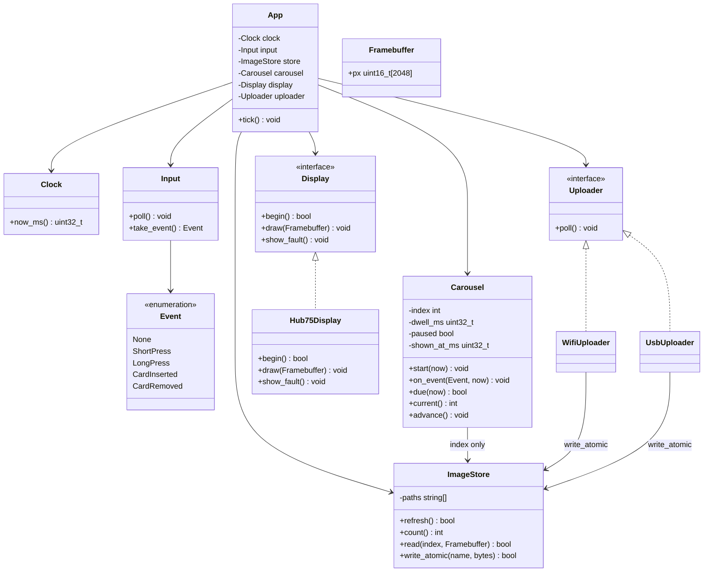
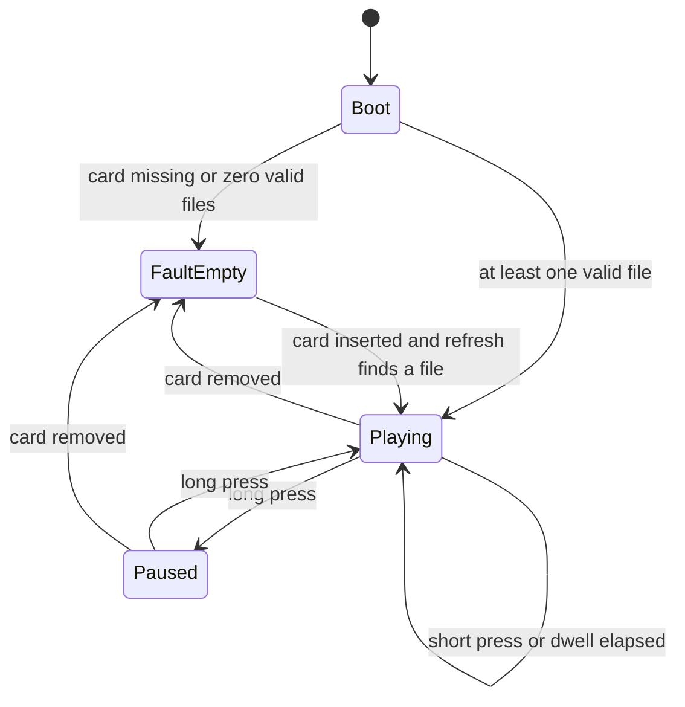
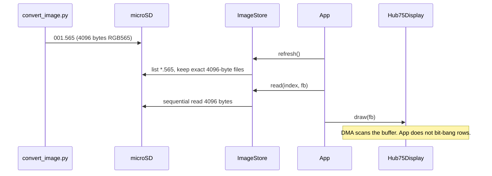
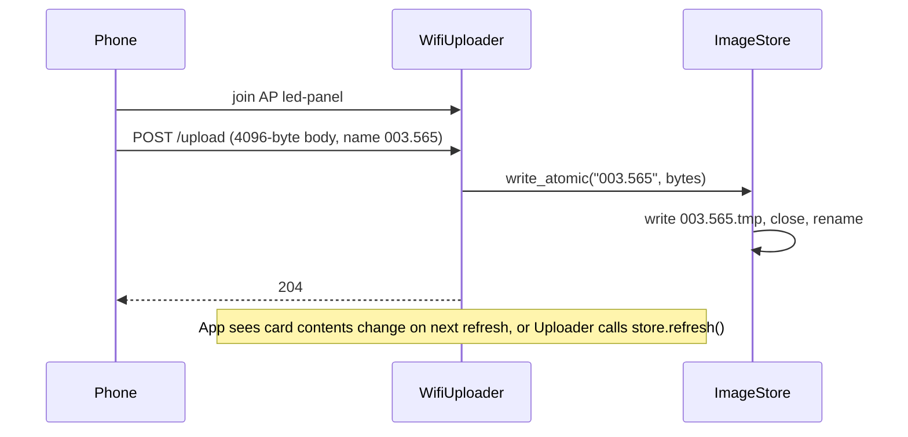
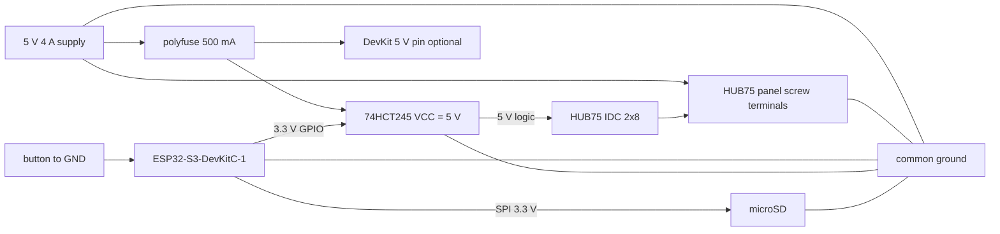

# Sensor LED Panel — Design

A small landscape LED panel that cycles through still images, the way an iPhone photo shuffle does when the phone is turned sideways. Pictures advance on a timer. A button skips or pauses. New pictures are loaded from a microSD card first. A private Wi-Fi upload page is the later path. There is no Ethernet.

This is a design note, not firmware and not fab files. Pin numbers below are a proposal. Confirm them against the ESP32-S3-DevKitC-1 pinout and the HUB75 library before ordering a board.

## Assumptions

- The picture is a **HUB75 RGB LED matrix, 64×32**, landscape, one panel. That is large enough to read a photo as coarse pixels and small enough that one frame is 4 KB.
- The controller is an **ESP32-S3-DevKitC-1** (USB-C, Wi-Fi, 8 MB flash). PSRAM is unused at this resolution.
- The ELEGOO Mega 2560 stays on the bench. It has 8 KB of SRAM and no radio, so it cannot hold a color frame or take a wireless upload.
- The panel does **not** decode JPEG. A script on the computer resizes and writes raw RGB565. The microcontroller only stores and blits.
- Version 1 loads images from a **microSD card**. Version 2 adds a **private Wi-Fi access point** and a browser upload page. USB-C serial upload is the fallback if Wi-Fi setup gets in the way. USB mass-storage mode is out of scope.

## Functional requirements

### Playback

| ID | Requirement |
| --- | --- |
| FR-1 | On power-up the panel shows the first image within 2 seconds, then advances on its own. |
| FR-2 | Images are shown in filename order (`001.565`, `002.565`, …), then the list wraps. |
| FR-3 | Each image stays up for a dwell time. Default is 5 seconds. The dwell is read from `carousel.cfg` on the card when that file exists. Allowed range is 1–60 seconds. |
| FR-4 | The panel is fixed landscape, 64×32. The host script center-crops every photo to 2:1 before upload. The device does not rotate. |
| FR-5 | With no images on the card, the panel shows a slow full-panel blink so a blank card is obvious. |
| FR-6 | Brightness is fixed at boot (about 30% so a 5 V / 4 A supply stays within budget). A later config key may change it. |

### Controls

| ID | Requirement |
| --- | --- |
| FR-7 | A short press of the front button advances to the next image and restarts the dwell timer. |
| FR-8 | A long press (hold ≥ 700 ms) pauses or resumes. While paused, the current image stays up and the dwell timer does not run. |
| FR-9 | Pulling the card out pauses playback. Reinserting the card reloads the file list and starts at the first image. |

### Storage and upload

| ID | Requirement |
| --- | --- |
| FR-10 | Images live on the microSD card as headerless RGB565, little-endian, exactly 64×32×2 = 4096 bytes. Any other size is skipped and counted as an error. |
| FR-11 | The card holds at least 20 images (80 KB of image data). A 1 GB card is enough. |
| FR-12 | Version 1: copying files onto the card from a computer is the only upload path. |
| FR-13 | Version 2: the device opens a private access point named `led-panel` (WPA2, password printed on the serial log and in this doc’s build notes). No home router and no Internet are required. |
| FR-14 | Version 2: a phone or laptop joins `led-panel`, opens `http://192.168.4.1`, and uploads a JPEG or PNG. The device rejects the file unless the host already converted it, **or** a small host script converts then uploads the `.565` bytes. The firmware path that must work is: receive a 4096-byte `.565` and write it to the card. |
| FR-15 | A failed or partial write must not replace a good file. Write to a temporary name, then rename. |
| FR-16 | USB-C serial (115200, a small framed protocol) can push the same 4096-byte records when Wi-Fi is disabled at build time. |

### Power and safety

| ID | Requirement |
| --- | --- |
| FR-17 | Matrix power is a separate 5 V supply into the panel screw terminals. The MCU 5 V pin never feeds the LEDs. |
| FR-18 | Panel ground, MCU ground, and level-shifter ground are tied together at one point. |
| FR-19 | HUB75 inputs are driven at 5 V through 74**HCT**245 buffers. A 74HC245 is not a substitute (its input-high threshold is too high for 3.3 V GPIO). |

### Out of scope

Video, animation timelines, live camera, accounts, cloud sync, Ethernet, brightness sensor, audio, and a custom enclosure beyond four mounting holes.

## Low-level design (C++)

Firmware is C++17 on PlatformIO, Arduino framework, because the HUB75 DMA library is maintained there. Application code does not include that library. `Hub75Display` is the only file that does.

One frame is 4096 bytes. The carousel keeps a single framebuffer. The next image is read into that buffer during the vertical blank of the swap, which at 64×32 is just “draw the buffer the DMA engine is not scanning,” if the library double-buffers. If the library has one buffer, `ImageStore` reads the file fully into the framebuffer between scans; a 4 KB SD read is fast enough that a one-frame glitch is acceptable for v1.

### File layout

```text
firmware/
  platformio.ini
  src/
    main.cpp                 // setup + loop calls App::tick()
    app.hpp / app.cpp        // owns the objects, runs the state machine
    carousel.hpp / carousel.cpp
    image_store.hpp / image_store.cpp
    framebuffer.hpp          // struct Framebuffer { uint16_t px[64*32]; }
    display.hpp              // pure virtual Display
    hub75_display.hpp / hub75_display.cpp
    input.hpp / input.cpp    // debounced button, short vs long press
    clock.hpp                // wraps millis() so tests can fake time
    upload/
      uploader.hpp           // pure virtual; v1 implementation is a no-op
      sd_catalog.hpp         // v1 "upload" = files already on the card
      usb_uploader.hpp       // FR-16, compiled out unless -DUPLOAD_USB
      wifi_uploader.hpp      // FR-13/14, compiled out unless -DUPLOAD_WIFI
host/
  convert_image.py           // Pillow: crop to 64x32, write RGB565
  panel_upload.py            // optional USB serial sender
```

### Class diagram



`Carousel` does not talk to pixels. `App::tick` is the only place that sequences “time to advance → read file → draw”.

### State machine



`tick()` order, every loop:

1. `input.poll()`
2. `uploader.poll()` (no-op in v1)
3. If the card state changed, `store.refresh()`
4. Hand the event to `carousel.on_event`
5. If `carousel.due(now)` or the index changed, `store.read` into the framebuffer and `display.draw`
6. If the store is empty, `display.show_fault` and skip the draw

### Frame path



### Wi-Fi upload path (v2)



`write_atomic` is shared with the USB uploader so there is one way to put bytes on the card.

### Host conversion

`convert_image.py` (not firmware):

- Open the photo, cover-crop to a 2:1 window from the center, resize to 64×32 with a box filter.
- Pack each pixel as RGB565 little-endian: `R5 = r>>3`, `G6 = g>>2`, `B5 = b>>3`, `uint16 = (R5<<11) | (G6<<5) | B5`.
- Write exactly 4096 bytes. Refuse to emit a file of any other length.

### What the DMA library is allowed to own

Row address lines (A–D), RGB data, clock, latch, and output-enable timing stay inside `Hub75Display`. The rest of the firmware sees `draw(fb)`. Swapping the panel for a different HUB75 library, or for a TFT later, means a new `Display` subclass.

### Build flags

| Flag | Effect |
| --- | --- |
| (default) | SD card playback only |
| `-DUPLOAD_USB` | CDC serial receiver on USB |
| `-DUPLOAD_WIFI` | SoftAP + one upload route |

Do not turn both uploaders on in the first bring-up. One path at a time.

## Estimated cost

Single unit, hobby prices in USD, parts only, shipping excluded. Figures are planning numbers, not quotes.

| Item | Qty | Estimate |
| --- | ---: | ---: |
| ESP32-S3-DevKitC-1 (8 MB flash, USB-C) | 1 | $10 |
| HUB75 64×32 indoor panel (P3 or P4) | 1 | $20–30 |
| 5 V, 4 A supply with barrel plug | 1 | $12 |
| 74HCT245 level shifter, DIP | 2 | $2 |
| microSD breakout + 16 GB card | 1 | $8 |
| 2×8 IDC ribbon, if the panel did not include one | 1 | $3 |
| Tactile button, 10 kΩ pull-up, pin header, wire | 1 set | $5 |
| **Bring-up on the dev board, no custom PCB** |  | **about $60–70** |
| JLCPCB 2-layer carrier, 5 boards, small | 1 order | $10–20 plus shipping |
| **With a carrier PCB** |  | **about $80–100** |

The Mega starter kit is not in this budget. It is not part of the build.

The panel is the expensive part and the part that changes the look. A 64×64 panel is roughly double the panel price and needs the extra `E` address line. Stay at 64×32 unless the 64×32 looks too coarse in person.

## Basic schematic

Logic is 3.3 V from the dev board. The panel LEDs are 5 V from their own supply. Signals from the ESP32 go through 74HCT245 parts powered at 5 V, then into the HUB75 connector. Grounds join.



### Power rules

- LED current stays on the panel’s own red and black leads. It does not enter the carrier board.
- The carrier’s 5 V rail only feeds the HCT buffers and, if you choose, the dev board. A 500 mA polyfuse is enough and keeps a short off the LED supply.
- Tie grounds: supply −, panel GND, dev board GND, HCT GND, SD GND.
- Do not feed 5 V into an ESP32 GPIO. The HCT chips are the only things that see both rails.

### Proposed GPIO map (64×32, no E line)

Avoid on this module: GPIO0, GPIO3, GPIO19, GPIO20 (USB), GPIO45, GPIO46 (strapping). Leave GPIO26–37 free so a PSRAM module can be dropped in later without a respin of the wiring diagram.

| HUB75 | GPIO | HCT |
| --- | ---: | --- |
| R1 | 4 | chip 1, bit 0 |
| G1 | 5 | chip 1, bit 1 |
| B1 | 6 | chip 1, bit 2 |
| R2 | 7 | chip 1, bit 3 |
| G2 | 8 | chip 1, bit 4 |
| B2 | 9 | chip 1, bit 5 |
| A | 10 | chip 1, bit 6 |
| B | 11 | chip 1, bit 7 |
| C | 12 | chip 2, bit 0 |
| D | 13 | chip 2, bit 1 |
| CLK | 14 | chip 2, bit 2 |
| LAT / STB | 15 | chip 2, bit 3 |
| OE | 16 | chip 2, bit 4 |

| Other | GPIO | Notes |
| --- | ---: | --- |
| Button | 21 | external 10 kΩ to 3.3 V, button to GND, active low |
| SD CS | 1 | SPI mode, 3.3 V card only |
| SD SCK | 2 | |
| SD MOSI | 17 | |
| SD MISO | 18 | |

74HCT245 wiring, both chips:

- `VCC` = fused 5 V, `GND` = common ground
- `DIR` tied high (A → B, ESP32 side is A)
- `OE` tied low (always enabled)
- 100 nF ceramic across VCC and GND, next to each chip
- ESP32 GPIO → `A` inputs. `B` outputs → HUB75 pins
- Unused `A` inputs on chip 2 (bits 5–7) tied to GND

HUB75 IDC, standard 2×8, looking into the panel socket. Confirm against the silkscreen on the panel you buy. Pin 1 is usually marked.

| Pin | Signal | Pin | Signal |
| ---: | --- | ---: | --- |
| 1 | R1 | 2 | G1 |
| 3 | B1 | 4 | GND |
| 5 | R2 | 6 | G2 |
| 7 | B2 | 8 | GND |
| 9 | A | 10 | B |
| 11 | C | 12 | D |
| 13 | CLK | 14 | LAT |
| 15 | OE | 16 | GND |

`E` is not on this 16-pin connector. A 64-row panel needs it. This design does not.

### Bring-up order

1. Dev board alone, USB-C, serial log prints the file list from the SD card.
2. Card with one known `.565` (full red, then full green, then full blue test frames).
3. HCT chips and the ribbon, panel on the 5 V supply, grounds joined, brightness cap in firmware before the first `draw`.
4. Button short and long press.
5. Only then enable `-DUPLOAD_WIFI` or `-DUPLOAD_USB`.

## PCB design

First hardware is the dev board, two DIP HCT chips, and the SD breakout on a solderless breadboard or perfboard. Order a PCB after a photo actually shows up on the panel.

The carrier is a 2-layer board. It sockets the DevKitC-1 on pin headers. It does not reflow the ESP32 module. USB-C stays on the dev board, so the carrier has no USB connector and no 5.1 kΩ CC resistors to get wrong.

### Placement

```text
+------------------------------------------------------+
|  (mount)                                     (mount) |
|                                                      |
|   [ ESP32-S3-DevKitC-1 on female headers ]           |
|   antenna end hangs off the board edge, no copper    |
|   under the antenna keep-out                         |
|                                                      |
|   [ 74HCT245 ] [ 74HCT245 ]      [ microSD slot ]    |
|                                                      |
|   [ HUB75 2x8, at the panel edge of the board ]      |
|   [ button ]                                         |
|                                                      |
|   5V logic tap ---- polyfuse ---- HCT VCC            |
|   GND pour                                           |
|  (mount)                                     (mount) |
+------------------------------------------------------+
```

- Outline about 70 × 50 mm, adjusted to the real DevKitC-1 drawing once the header row spacing is measured. Do not trust a copied outline.
- Four M3 mounting holes, 3.2 mm drills, 6 mm from the corners, outside the header courtyard.
- HUB75 header on the edge that faces the panel so the ribbon is short (under 20 cm).
- SD slot on an edge a finger can reach.
- Button near the same edge as the SD slot.

### Electrical

| Net | Copper |
| --- | --- |
| GPIO and SPI | 0.25 mm traces |
| HCT 5 V and its ground return | 0.8 mm, or a pour |
| Panel LED 5 V | **not on this board** |
| Ground | bottom-layer pour, stitched with vias at each chip and at the HUB75 ground pins |

- 100 nF decoupling at each HCT VCC pin, and at the SD VCC pin.
- Series 33 Ω on CLK, LAT, and OE next to the HCT outputs if the ribbon rings in bring-up. Footprints can be populated with 0 Ω until then.
- No traces under the DevKit antenna. Keep that strip free of copper on both layers.
- Silkscreen: `5V LOGIC ONLY`, `LED POWER IS OFF-BOARD`, pin-1 mark on the HUB75 header, button legend `NEXT / HOLD PAUSE`.

### What this PCB is not

It is not an LED driver board, not a 4 A power plane, and not an ESP32 module layout. Those are the three ways this project gets expensive. Socket the dev board, shift the levels, hold the SD card, and stop.

## Bring-up checklist

- [ ] `convert_image.py` emits a 4096-byte file and a full-red / full-green / full-blue set.
- [ ] Firmware lists those files on serial and draws them in order at 5 s.
- [ ] Short press skips. Long press pauses.
- [ ] Empty card blinks. A 4097-byte file is ignored.
- [ ] Panel screw current at the chosen brightness stays under 3 A on the 4 A supply.
- [ ] v2 only: phone joins `led-panel`, upload of one `.565` appears in the rotation without a reboot.
